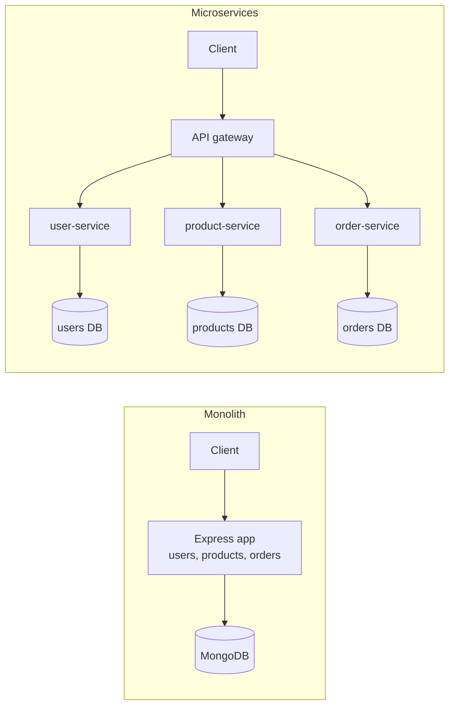

# Monolith vs Microservices

[](https://github.com/andresazcona/architecture-comparison/actions/workflows/ci.yml)
[](LICENSE)


The same small e-commerce API (users, products, orders) built twice, once as a monolith and once as microservices behind an API gateway, plus k6 load and resilience scripts to compare how the two behave under load and when a component fails.

## Architecture



| | Monolith | Microservices |
| --- | --- | --- |
| Deployment | One process | Gateway plus three services, one container each |
| Data | One MongoDB database | One database per service (same MongoDB instance in Compose) |
| Auth | JWT issued by the login route | Same JWT, signed with a shared `JWT_SECRET` and verified by each service |
| Failure mode | A crash takes everything down | The gateway answers `503` for the failed service; the others keep working |

## API

Identical in both setups (port 3000 in both cases).

| Method | Route | Auth | Description |
| --- | --- | --- | --- |
| `POST` | `/api/users/register` | no | Register (`username`, `email`, `password`) |
| `POST` | `/api/users/login` | no | Log in with `username` or `email`; returns a JWT |
| `GET` | `/api/users/profile` | yes | Profile of the authenticated user |
| `GET` | `/api/products` | no | List products |
| `POST` / `PUT` / `DELETE` | `/api/products[/:id]` | yes | Manage products |
| `POST` / `GET` | `/api/orders` | yes | Create an order (`productId`, `quantity`) / list your orders |
| `GET` / `PUT` | `/api/orders/:id` | yes | Read / update one of your orders |

Authenticated routes expect `Authorization: Bearer <token>`.

## Quick start

Requires Node.js 18+ and a MongoDB instance.

```bash
# Monolith (MONGO_URI defaults to mongodb://localhost:27017/ecommerce)
cd monolithic
npm install
npm start
```

```bash
# Microservices: gateway on http://localhost:3000, MongoDB included
cd microservices
docker compose up --build
```

Configuration is through environment variables: `PORT`, `MONGO_URI` (the services also accept `DATABASE_URL`), `JWT_SECRET` (set a real value outside development) and, for the gateway, `USER_SERVICE_URL`, `PRODUCT_SERVICE_URL` and `ORDER_SERVICE_URL`.

## Tests

```bash
# Functional smoke test against a running monolith or gateway (Node 18+)
node tests/smoke.js http://localhost:3000
```

CI starts the monolith and the microservices against a MongoDB service container and runs the smoke test against each. The k6 load and resilience scripts and the comparison report are described in [tests/README.md](tests/README.md); they are run manually and are not part of CI.

## Project structure

```
.
├── monolithic/            # Single Express app (controllers, models, routes, middleware)
├── microservices/
│   ├── api-gateway/       # Forwards /api/users, /api/products, /api/orders
│   ├── user-service/
│   ├── product-service/
│   ├── order-service/
│   └── docker-compose.yml
├── kubernetes/            # Deployment templates for the gateway and services
├── tests/                 # smoke test, k6 scripts, report generator
└── .github/workflows/     # CI
```

## Kubernetes

The manifests in `kubernetes/` are starting templates, not a tested deployment. Replace the image names (`your-docker-repo/...`) and database URLs, and provide a `mongo` service and a `JWT_SECRET` before applying them with `kubectl apply -f kubernetes/`.

## License

[MIT](LICENSE)
